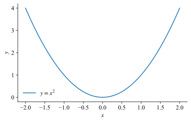

Here's some inline math: $y = x^2$. And some display math:

$$
\begin{equation}
\frac{1}{2} = \frac{2}{4}.
\end{equation}
$$

Below is a parabola.

<figure>
  
  <figcaption>This is a caption with some math: $y = x^2$.</figcaption>
</figure>

Some more: $\{1,2,3\}$.